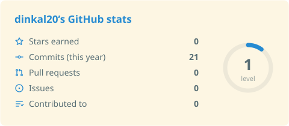
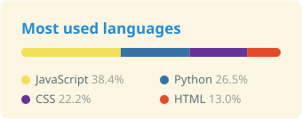
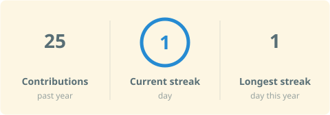
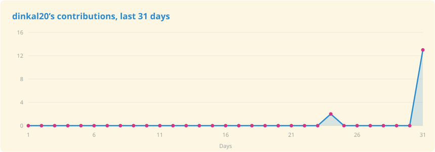

<!-- studio:settings user=dinkal20 theme=tokyonight hl=2 border=hide follow=on light=solarized-light -->

<!-- studio:banner -->

  <picture>
    <source media="(prefers-color-scheme: dark)" srcset="https://raw.githubusercontent.com/dinkal20/dinkal20/main/profile-assets/banner-dark.svg?text=Dinkal%20Leuva&shape=waving&paint=theme&animation=scaleIn&section=header&height=180&fontSize=52" />
    
  </picture>

<!-- studio:header -->
<h1 align="center">Hi, I'm Dinkal Leuva 👋</h1>

I'm a B.Tech Information Technology student with a passion for coding, problem-solving, and building things that make a difference.

  <picture>
    <source media="(prefers-color-scheme: dark)" srcset="https://raw.githubusercontent.com/dinkal20/dinkal20/main/profile-assets/typing-dark.svg?lines=%F0%9F%92%BB%20Exploring%20software%20development%20and%20web%20technologies;%F0%9F%8C%B1%20Always%20learning%20and%20experimenting%20with%20new%20ideas;%F0%9F%9B%A0%EF%B8%8F%20Turning%20concepts%20into%20practical%20projects;%F0%9F%9A%80%20Growing%20one%20line%20of%20code%20at%20a%20time!&font=Righteous&size=12&width=460&center=true" />
    
  </picture>

<!-- studio:stack after=1 -->
<h2 align="center">Tech stack</h2>

  <b>Languages</b> 
  <picture>
    <source media="(prefers-color-scheme: dark)" srcset="https://raw.githubusercontent.com/dinkal20/dinkal20/main/profile-assets/stack-languages-dark.svg?i=py%2Cjs%2Cjava%2Chtml%2Ccss%2Cc%2Ccpp&perline=10" />
    
  </picture>

  <b>Frameworks</b> 
  <picture>
    <source media="(prefers-color-scheme: dark)" srcset="https://raw.githubusercontent.com/dinkal20/dinkal20/main/profile-assets/stack-frameworks-dark.svg?i=flask%2Cflutter%2Csklearn%2Copencv&perline=10" />
    
  </picture>

  <b>Tools</b> 
  <picture>
    <source media="(prefers-color-scheme: dark)" srcset="https://raw.githubusercontent.com/dinkal20/dinkal20/main/profile-assets/stack-tools-dark.svg?i=git%2Cgcp%2Cvscode%2Cmongodb&perline=10" />
    
  </picture>

 

<!-- studio:ownstats cards=stats.langs.streak n=6 after=1 -->
<h2 align="center">📂 My Digital Footprint</h2>

  <picture>
    <source media="(prefers-color-scheme: dark)" srcset="https://raw.githubusercontent.com/dinkal20/dinkal20/main/profile-assets/card-own-stats-dark.svg" />
    
  </picture>
  <picture>
    <source media="(prefers-color-scheme: dark)" srcset="https://raw.githubusercontent.com/dinkal20/dinkal20/main/profile-assets/card-own-langs-dark.svg" />
    
  </picture>
  <picture>
    <source media="(prefers-color-scheme: dark)" srcset="https://raw.githubusercontent.com/dinkal20/dinkal20/main/profile-assets/card-own-streak-dark.svg" />
    
  </picture>

 

<!-- studio:activity after=1 -->
<h2 align="center">✨ My Journey in Code</h2>

  <picture>
    <source media="(prefers-color-scheme: dark)" srcset="https://raw.githubusercontent.com/dinkal20/dinkal20/main/profile-assets/card-activity-dark.svg?area=true" />
    
  </picture>

 

<!-- studio:snake snake=8250df dots=purple after=1 -->
<h2 align="center">📊 Contribution Activity</h2>

  <picture>
    <source media="(prefers-color-scheme: dark)" srcset="https://raw.githubusercontent.com/dinkal20/dinkal20/main/profile-assets/card-snake-dark.svg?snake=8250df&dots=purple" />
    
  </picture>

 

<!-- studio:repos after=1 -->
<h2 align="center">🚀 Featured projects</h2>

  <a href="https://github.com/dinkal20/my-best-project"><picture>
    <source media="(prefers-color-scheme: dark)" srcset="https://raw.githubusercontent.com/dinkal20/dinkal20/main/profile-assets/card-repo-my-best-project-dark.svg?username=dinkal20&repo=my-best-project" />
    
  </picture></a>
  <a href="https://github.com/dinkal20/another-one"><picture>
    <source media="(prefers-color-scheme: dark)" srcset="https://raw.githubusercontent.com/dinkal20/dinkal20/main/profile-assets/card-repo-another-one-dark.svg?username=dinkal20&repo=another-one" />
    
  </picture></a>

 

<!-- studio:socials -->
<h2 align="center">🤝 Find me</h2>

  <a href="https://www.linkedin.com/in/dinkal-leuva-044640375"><picture>
    <source media="(prefers-color-scheme: dark)" srcset="https://raw.githubusercontent.com/dinkal20/dinkal20/main/profile-assets/icon-linkedin-dark.svg?i=linkedin" />
    
  </picture></a>
  <a href="mailto:leuvadinkal@gmail.com"><picture>
    <source media="(prefers-color-scheme: dark)" srcset="https://raw.githubusercontent.com/dinkal20/dinkal20/main/profile-assets/icon-email-dark.svg?i=gmail" />
    
  </picture></a>

